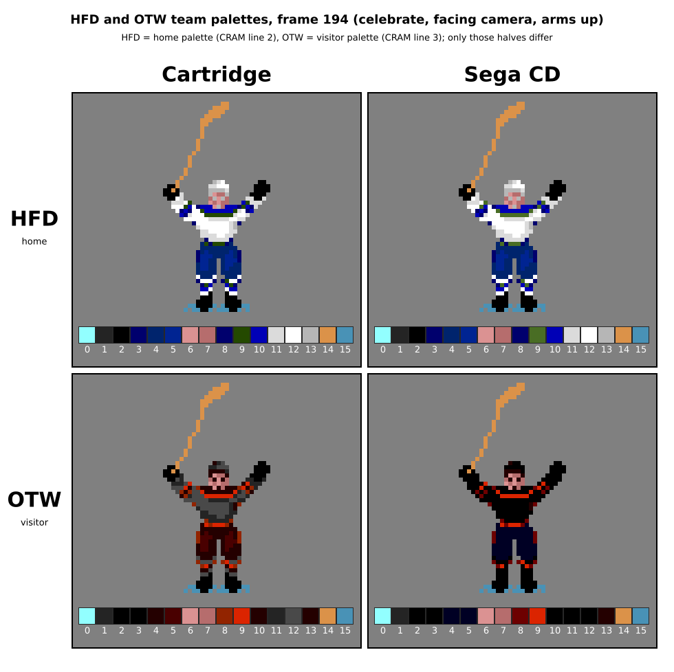

# NHL 94: cartridge vs Sega CD differences

This page lists every difference found between the retail cartridge game and the Sega CD game code (`HOCKEY.BIN`), in gameplay first, then everything else. The short answer: the Sega CD plays the same game. Skating, puck physics, AI assignments, shooting, goalies, checking, penalties, line changes, period lengths and overtime are the same code. Three small code changes touch play, and the rosters drop 31 players with the lines rebuilt around them.

Each item is marked:

- **Verified**: the instructions or bytes were compared directly in both builds.
- **Inferred**: what the verified change does in a game, read from the code but not measured in play.

Cartridge source references are to this repo (`src/`). Disc source references are to the transcribed disc code in `src/segacd/hockey/` where it exists. Cartridge addresses are ROM addresses. Disc addresses are `HOCKEY.BIN` runtime addresses (file offset + `$1B000`).

Players are named as the retail team data spells them (the ROM shortens some long names, for example `John Vanbiesbrk`), with their cartridge roster number (`#n`, 1-based, the numbers `.ls` uses). The source in `src/teamdata94.asm` has placeholders for the names; the roster numbers match it.

## Gameplay differences

### 1. Skaters accelerate slightly faster on the Sega CD (verified; effect inferred)

| | Cartridge | Sega CD |
| --- | --- | --- |
| Routine | `playeracc`, `src/engine/logic94.asm` 7489, `.incagl` at 7517-7518 | `playeracc`, `src/segacd/hockey/logic94cd.asm` 6319, lines 6344-6345 |
| Address | `$10C08`-`$10C16` | `$368C0`-`$368D4` |
| Code | `addq.b #2,d2` once | `addi.b #2,d2` twice (+4) |

The acceleration term is `$40 - weight/4 + legstr`, plus the "crowd meter boost", then halved (`asr.w #1,d2`) and multiplied into the stick direction. The boost is gated on `sflags8` bit 1 or `sflags7` bit 6. `SetSflags8Bit1` (`src/helpers94.asm` 5) always sets `sflags8` bit 1, and `updateplayers` calls it every update (`src/engine/logic94.asm` 37; disc `$2AE68`, called from `$2FA14`). So the boost applies to every skater on both teams, all the time.

Inferred effect: after the halving, every player's acceleration term is 1 unit higher on the Sega CD. Goalies take the same path (the +4 comes before the goalie doubling of `legstr` + `$10`). The top-speed code that follows (+2, capped at `$1E`) is unchanged.

The code, cartridge (`src/engine/logic94.asm` 7507-7525):

```asm
    clr.w   d2
    move.b  weight(a3),d2           ; weight nibble * 8
    lsr.w   #2,d2
    neg.w   d2
    addi.w  #$40,d2                 ; $40 - weight/4
    add.b   legstr(a3),d2           ; + legstr
    btst    #1,(sflags8).w          ; always set (SetSflags8Bit1)
    bne.w   .incagl
    btst    #6,(sflags7).w
    beq.w   .incaglg
.incagl
    addq.b  #2,d2                   ; boost +2
.incaglg
    tst.w   position(a3)            ; goalie?
    bne.w   .noy2
    add.b   legstr(a3),d2           ; goalie: + legstr
    addi.w  #$10,d2                 ;         + 16
.noy2
    asr.w   #1,d2                   ; halve
    muls.w  d2,d0
    muls.w  d2,d1
```

Sega CD (`src/segacd/hockey/logic94cd.asm` 6334-6352). It is the same apart from the boost:

```asm
    btst    #$1,(sflags8).l
    bne.w   .next3
    btst    #$6,(sflags7).l
    beq.w   .incaglg
.next3  addi.b  #$2,d2              ; boost +2 ...
    addi.b  #$2,d2                  ; ... and +2 again
.incaglg    tst.w   position(a3)
```

After this, both builds do `asr.l #5` on `d0`/`d1` and then `muls.w d7` (frames elapsed), so the acceleration added this frame is proportional to the halved term.

How the size is worked out (verified arithmetic; the feel in play is inferred):

1. `setplayer` (`src/engine/collide94.asm` 2888-2896) reads the player's weight/leg byte (`pldweight`, `src/ram94.asm` 187). `weight` = weight nibble × 8. `legstr` = `AttributeCalc` of the leg nibble (`src/front/crowd94.asm` 211): 5 × nibble plus the hot/cold value ÷ 3, clamped to 0-`$1E` (30).
2. `playeracc`: `weight/4` is 2 × the weight nibble, so the term is `64 - 2W + legstr`, where W is the weight nibble.
3. Boost: +2 on the cartridge, +4 on the Sega CD, for every player (see above).
4. Goalies only (`position` = 0): + `legstr` + 16.
5. Halve with `asr.w #1`. The extra 2 is even, so the Sega CD's halved term is always exactly 1 higher.

So the gain is `1 / (cartridge halved term)`:

| Player | Cartridge halved term | Sega CD | Gain |
| --- | --- | --- | --- |
| Skater, any ratings (W 0-15, `legstr` 0-30) | `(66 - 2W + legstr) / 2`: 18 to 48 | 19 to 49 | +2.1% to +5.6% |
| Goalie, any ratings | `(82 - 2W + 2 × legstr) / 2`: 26 to 71 | 27 to 72 | +1.4% to +3.8% |
| Skaters in the retail rosters (619) | 21 to 44 | 22 to 45 | +2.3% to +4.8%, median +3.1% |
| Goalies in the retail rosters (65) | 43 to 65 | 44 to 66 | +1.5% to +2.3%, median +2.0% |

The retail-roster rows use the cartridge team data with hot/cold = 0. In that data the weight nibble runs 3-14 for skaters and the leg nibble 0-6, so `legstr` is 0-30. The extremes are Jay Caufield (PIT, weight 14, legs 1: 21 → 22, +4.8%) and Wayne Gretzky (LA, weight 4, legs 6: 44 → 45, +2.3%). For goalies they are Ken Wregget (PIT, 43 → 44) and Patrick Roy (MTL, 65 → 66). A hot or cold streak moves `legstr` by the hot/cold value ÷ 3 and shifts these slightly. Heavy, low-agility players gain the most in relative terms.

### 2. A checked player bounces off the corners much more easily (bytes verified; effect inferred)

| | Cartridge | Sega CD |
| --- | --- | --- |
| Routine | `checkcornercoll`, `src/front/crowd94.asm` 109, compare at 149 | `checkcornercoll`, `src/segacd/hockey/crowd94cd.asm` 90, compare at 128 |
| Address | `$F703E`: `b6bc 0000 1000` | `$2302A`: `0c83 0000 0042` |
| Code | `cmp.l #$1000,d3` (corner radius 64, squared) | `cmpi.l #$42,d3` (radius about 8) |

`checkcornercoll` tests the distance squared from the corner circle's centre. At or under the threshold (`bls .exit`) there is no corner hit. The only caller is `wallcollduringcheck` (`src/front/cards94.asm` 232-245; disc call at `$24FEE`, `src/segacd/hockey/cards94cd.asm` 222). That routine runs for a skater being body-checked near the boards, with his box grown by `$17`.

Inferred effect: on the cartridge, a checked player gets the corner bounce only when he is pushed past the curve of the corner. On the Sega CD, he gets it almost anywhere in a corner zone. `$42` looks like a typo for the radius. The normal skater/wall collision in `wallcoll` keeps `$1000` in both (`src/engine/collide94.asm` 1057; disc `src/segacd/hockey/collide94cd.asm` 942).

### 3. Pad input during the penalty-shot box (verified)

| | Cartridge | Sega CD |
| --- | --- | --- |
| Routine | `doinput`, `src/engine/logic94.asm` 517, `.5` at 543-548 | `doinput`, `src/segacd/hockey/logic94cd.asm` 442, lines 463-476 |
| Address | `$B140`-`$B158` | `$3025C`-`$30292` |

`PenaltyShotBox` (`src/engine/setup94.asm` 2500) sets `gmode2` bit 7 while the PENALTY SHOT box (or, in Shootout mode, the shootout box) is shown.

- Cartridge: while the bit is set, a d-pad press calls `ShortenMsgTimer` (`src/engine/period94.asm` 753). The pad input then goes on to the player as normal.
- Sega CD: while the bit is set, bit 6 (the A button) is cleared in `d0`-`d3`. If the d-pad is pressed, it calls `ShortenMsgTimer` and then forces `d0 = 8` (no direction) and `d1 = d2 = d3 = 0`. The pad does nothing else during the box.

### 4. Rosters, lines and goalie counts (verified)

Both builds have the same 28 teams (26 NHL teams and the two All-Star teams). Florida and Anaheim are byte-identical. The disc drops 31 player records from 20 teams. 28 of them are players the cartridge also lists on Florida or Anaheim, so the cartridge has them twice. The other three (Bobby Smith, DAL #7; Dan Marois, NYI #16; Rick Wamsley, TOR #3) are not on any other team.

Every remaining player's record (name and all ratings) is byte-identical. The team `.sr` bytes 0-2 (simulated scoring odds, power play / penalty kill and home/visitor bonuses) are the same on all teams.

Removed players (cartridge roster number; G, F or D from the team's goalie and forward counts):

| Team | Removed |
| --- | --- |
| BOS | Gord Murphy #22 D |
| BUF | Bob Corkum #16 F |
| CGY | Brian Skrudland #6 F, Alexnder Godynyuk #24 D |
| CHI | Stu Grimson #11 F |
| EDM | Ron Tugnutt #2 G, Scott Mellanby #16 F |
| HFD | Terry Yake #5 F, Randy Ladouceur #24 D |
| LA | Lonnie Loach #10 F |
| DAL | Bobby Smith #7 F |
| MTL | Sean Hill #24 D |
| NJ | Alexei Kasatonov #22 D |
| NYI | Mark Fitzpatrik #2 G, Tom Fitzgerald #15 F, Dan Marois #16 F |
| NYR | John Vanbiesbrk #1 G, Steven King #11 F, Joe Cirella #25 D |
| PHI | Andrei Lomakin #12 F, Gord Hynes #24 D |
| PIT | Troy Loney #9 F |
| QUE | Mike Hough #8 F, Bill Lindsay #11 F |
| SJ | Robin Bawa #9 F, David Williams #22 D |
| STL | Guy Hebert #2 G, Dave Lowry #10 F |
| TB | Randy Gilhen #11 F |
| TOR | Rick Wamsley #3 G |
| VAN | Anatoli Semenov #5 F |

Unchanged: ASE, ASW, DET, OTW, WPG, WSH, FLA, ANH.

**Goalie counts.** `.godds` is one nibble per goalie, and `GetGoalieCount` (`src/front/stats94.asm` 2117) counts the nibbles. The changes are:

| Team | Cartridge | Sega CD | Goalies |
| --- | --- | --- | --- |
| EDM | `$D500` | `$D000` | 2 → 1 |
| NYI | `$9700` | `$9000` | 2 → 1 |
| NYR | `$9600` | `$9000` | 2 → 1 |
| STL | `$D400` | `$D000` | 2 → 1 |
| TOR | `$9610` | `$9600` | 3 → 2 |

The weights themselves are read only by `PickStartingGoalie` (`src/engine/setup94.asm` 1482), which nothing calls in the cartridge. The starting goalie is the G slot in the lines.

**Forward counts.** The high nibble of `.sr` byte 3 is the forward count (`srforwards`, `src/ram94.asm` 232; `GetForwardCount`, `src/front/stats94.asm` 2144, used by the line editor and player cards). It drops by the number of forwards removed. TOR also drops 14 → 13 with no forward removed: its cartridge #17 (Ken Baumgartnr) falls in the defense group on the disc, and the disc lines play him on defense. The low nibble is not read by the code. It changes on most teams, including OTW, whose roster is unchanged.

**Lines.** `.ls` (8 lines × G, LD, RD, LW, C, RW, extra attacker) was renumbered for the shorter rosters. These are the slots whose player differs, compared by player, not by number:

| Team | Line slot changes (cartridge → Sega CD) |
| --- | --- |
| BOS | Chk LD Gord Murphy (#22)→Gordie Roberts (#23), RD Gordie Roberts (#23)→Glen Feathrston (#24); PP2 LD Gord Murphy (#22)→Gordie Roberts (#23); PK1 LD Don Sweeney (#19)→Ray Bourque (#18), RD Ray Bourque (#18)→Don Sweeney (#19) (swapped) |
| EDM | Sc2 RW Scott Mellanby (#16)→Steven Rice (#17); PP2 RW Scott Mellanby (#16)→Steven Rice (#17) |
| HFD | NLC XA Terry Yake (#5)→Mikael Nylander (#6); Sc1 XA Terry Yake (#5)→Robert Kron (#7); Sc2 LD Randy Ladouceur (#24)→Dan Keczmer (#22), C Terry Yake (#5)→Robert Kron (#7); PP2 C Terry Yake (#5)→Mikael Nylander (#6), RW Mikael Nylander (#6)→Robert Kron (#7); PK1 LD Randy Ladouceur (#24)→Adam Burt (#21) |
| LA | Chk LW Lonnie Loach (#10)→Pat Conacher (#11) |
| DAL | PP1 LW Russ Courtnall (#11)↔RW Ulf Dahlen (#12) (swapped) |
| NJ | Sc2 RD Alexei Kasatonov (#22)→Tommy Albelin (#24) |
| NYI | NLC XA Derek King (#10)→Dave Volek (#11); Chk RW Tom Fitzgerald (#15)→Brad Dalgarno (#14); PK1 XA Tom Fitzgerald (#15)→Brad Dalgarno (#14); PK2 C Tom Fitzgerald (#15)→Brad Dalgarno (#14) |
| NYR | G John Vanbiesbrk (#1)→Mike Richter (#2) in all 8 lines; Chk RD Joe Cirella (#25)→Jay Wells (#24); PK2 RD Joe Cirella (#25)→Kevin Lowe (#22) |
| PHI | Sc1 XA Rod BrindAmour (#5)→Keith Acton (#8); Sc2 LW Andrei Lomakin (#12)→Keith Acton (#8) |
| PIT | Sc2 LW Troy Loney (#9)→Jeff Daniels (#10) |
| QUE | Sc2 LW Mike Hough (#8)→Gino Cavallini (#9); PP2 C Mats Sundin (#14)↔RW Andrei Kovalenko (#16) (swapped) |
| SJ | PP2 C Rob Gaudreau (#5)↔RW Dean Evason (#6) (swapped) |
| STL | NLC LD Jeff Brown (#17)↔RD Garth Butcher (#18) (swapped); Sc2 LW Dave Lowry (#10)→Bob Bassen (#7); PK1 RW Dave Lowry (#10)→Igor Korolev (#9); PK2 LW Dave Lowry (#10)→Igor Korolev (#9) |
| TOR | Every line except NLC has new D pairs: Sc1 Drake Berehowsky (#21)/Ken Baumgartnr (#17), Sc2 Bob Rouse (#23)/Jamie Macoun (#22), Chk Todd Gill (#18)/Dave Ellett (#19), PP1 Todd Gill (#18)/Ken Baumgartnr (#17), PP2 Dave Ellett (#19)/Drake Berehowsky (#21), PK1 Todd Gill (#18)/Bob Rouse (#23), PK2 Drake Berehowsky (#21)/Ken Baumgartnr (#17) |
| VAN | Sc1 XA Anatoli Semenov (#5)→Tom Fergus (#6); Sc2 C Anatoli Semenov (#5)→Tom Fergus (#6); PP1 LW Pavel Bure (#13)↔RW Trevor Linden (#14) (swapped); PK1 C Anatoli Semenov (#5)→Murray Craven (#8); PK2 RW Pavel Bure (#13)→Murray Craven (#8), XA Anatoli Semenov (#5)→Pavel Bure (#13) |

The other teams that lost players (BUF, CGY, CHI, MTL, TB) had them in no line, so their lines name the same players. The team palettes differ for HFD and OTW (visual only, see the non-gameplay section).

### 5. Playoff password: pad layout decoding (verified; minor)

| | Cartridge | Sega CD |
| --- | --- | --- |
| `ReadPassBits` remap | `src/engine/setup94.asm` 1905-1912, `$180A6`-`$180C8`: without the 4-way adaptor, `pojoy` 1 or 2 becomes 4 | `src/segacd/hockey/setup94cd.asm` 1635-1643, `$405EA`-`$40620`: only with the adaptor, 1 becomes 3 and 2 becomes 4 |
| `ContinuePlayoffs` | `src/engine/setup94.asm` 1575, `$17CD8`: `blt` (subtract 2 when `pojoy` ≥ 2) | `src/segacd/hockey/setup94cd.asm` 1374, `$40176`: `ble` (subtract 2 when `pojoy` > 2) |

With the 4-way adaptor, both builds end with the same `pojoy` and `OptNOP`. Without it, a password with pad layout 1 or 2 restores a different `pojoy` (1 or 2 on the disc, 4 on the cartridge). For layout 1, `OptNOP` also comes out different: 6 on the disc, 5 on the cartridge. Inferred effect: which pads control which team in a continued playoff can differ. Nothing in play itself changes.

## Changed code with no gameplay effect

- **`ClearShotData`** (`src/engine/hockey94.asm` 75, verified): the cartridge clears `$E4` words from `outputbuffer`, a 113-word buffer, so it runs on into the FM driver's tables. The disc clears `$72` words. The overrun is fixed. Details below.
- **`puckgoalie` save tables** (`src/engine/collide94.asm` 2229; `lea .list2` 2265, `lea .list3` 2275, tables 2370 and 2446; verified bytes, inferred effect): on the disc both `lea`s point at `$3C246` inside `deflect`'s code (`$3C0A0` and `$3C0C6`; `src/segacd/hockey/collide94cd.asm` 1974 and 1983), and the tables are not on the disc. The value read from them is overwritten before use in both builds (`a2touchpuck` clears `d0`, and so do `.bounceoff` / `.chkanim`), so the result does not change.
- **Random numbers** (verified code; inferred values): every read of the VDP HV counter for random bits goes through main-CPU command `$1B` (or `$1C` for a byte). The logic is the same, but the values differ in practice. Details below.
- **Sound ids**: the "ding" `sfx` id is `1` (`SFXbeep1`) → `2` in `assnearest`, `asspuckc` and `breakaway`. `dopass` stores its `sfx` value with `move` instead of `addi`.
- **Music**: `puckfaceoff` and `Goal` call `song` directly instead of queuing a song through `sflags8` bit 4 and the cartridge song queue.
- **`GetDefenseStart`** (`src/front/stats94.asm` 2130): a redundant `andi #$F` is dropped.
- **`CountButtonPress`** (`src/ui94.asm` 367): a smaller `movem` register list. Otherwise the same.
- **`PeriodOver_sp`** (`src/engine/setup94.asm` 757): the two waits for the next vblank around `p_turnoff` are gone.
- **`StartGame`** (`src/engine/hockey94.asm` 39): the same set-up, plus CD loading and one extra cleared word.
- **`StartHL2`** (`src/engine/scoreboard94.asm` 840): the saved block size is `$5BD` → `$557` (the disc RAM layout).
- **Hardware glue**: VDP writes, DMA, palette fades and bitmaps go through sub→main gate commands. `move #$2700,sr` became `bclr #5,$FF800F`. The vblank handler ends in `rts` instead of `rte`. `waitx` uses `or` instead of `move`. `LineEditorExit` has a different wait loop. `UpdateScoutingDisplay` is rewritten for the CD scouting report.
- **RAM layout**: the team struct is 2 bytes longer (`$364` → `$366`). Field `$22` became a long, so every team field from `$24` up is 2 bytes further on (for example `$1A2` → `$1A4`). Every use was checked to be the same field.

### `ClearShotData` overrun fix (verified)

`StartGame` calls `ClearShotData` when `OptPlayMode` is 2 or more (`src/engine/hockey94.asm` 53-55). The disc does the same; the transcription has the routine as `ClearShotData` in `src/segacd/hockey/logos94cd.asm` (call at 501, body at 520).

```asm
; cartridge (src/engine/hockey94.asm 75)     ; Sega CD (logos94cd.asm 520)
ClearShotData                                ClearShotData  move.w  #$71,d0
    move.w  #$E3,d0                                  movea.l #outputbuffer,a0
    movea.w #(outputbuffer-M68K_RAM),a0      .loop3  clr.w   (a0)+
.0  clr.w   (a0)+                                    dbra    d0,.loop3
    dbf     d0,.0                                    rts
    rts
```

(The disc line loads the disc's `outputbuffer` address, the same one the disc uses where the cartridge's `setup94.asm` 2105 and 2142 use `outputbuffer`, at `setup94cd.asm` 1826 and 1861.)

- `dbf` runs count + 1 times. So the cartridge clears `$E4` = 228 words and the disc clears `$72` = 114 words.
- The cartridge RAM map (`src/ram94.asm` 840-848) has `outputbuffer` (113 words), then `marker` (1), then `tpassbits` (5). After those come the FM driver's state: `music_needs_z80_update` (1 word), `Z80_command_buffer` + `per_channel_attenuation_table` (12 bytes), `per_channel_frequency_table` (7 words), `per_channel_patch_table` (4 words) and `fm_voice_usage_table` (256 words).
- So the cartridge clears `tpassbits`, all of those FM tables, and the first 91 words of `fm_voice_usage_table` (arithmetic from the RAM map). The disc stops at `marker`, the end of the saved block.
- Inferred: on the cartridge, a new game that clears the shot buffer also wipes `tpassbits` (temporary password bits) and the sound driver's per-channel state. Whether that is ever audible was not checked. The Sega CD's music comes from CD audio, so those tables don't drive its music.

### Random bits from the beam counter: main-CPU command `$1B` (verified code; values inferred)

On the cartridge, game code reads the VDP's HV counter (`HVcount` = `$C00008`, `src/ram94.asm` 72) directly whenever it wants a random bit. The sub CPU can't reach the VDP, so on the Sega CD each read is a request to the main CPU.

```asm
; cartridge updatecrowdf, crowd frame timer (src/engine/hockey94.asm 287)
    move.w  (HVcount).l,d2          ; beam position
    and.w   d1,d2                   ; random 0..time

; Sega CD, the same place (src/segacd/hockey/hockey94cd.asm 207-219)
.loop   btst    #$7,$FF800E.l       ; wait until the main CPU is free
    bne.b   .loop
    move.w  #$1B,$FF8020.l          ; command $1B: read the HV counter
    bset    #$6,$FF800F.l           ; "command waiting"
.loop2  btst    #$6,$FF800E.l       ; wait for "done"
    beq.b   .loop2
    move.w  $FF8010.l,d2            ; the main CPU's reply
    bset    #$7,$FF800F.l           ; acknowledge
    bclr    #$6,$FF800F.l
.loop3  btst    #$6,$FF800E.l
    bne.b   .loop3
    bclr    #$7,$FF800F.l
    and.w   d1,d2
```

On the main CPU, command `$1B` is the one-line handler `move.w $C00008,$A12010` (`src/segacd/main/hwread94cd.asm`; `$1C` is the byte form, `move.b`). It is reached through the main command table described below.

- **Count (verified):** `HOCKEY.BIN` has 21 `$1B` requests and 2 `$1C` requests. The two `$1C` are the cartridge's two `move.b (HVcount)` in `CCStart` (`collide94.asm` 432, 443). The disc transcription in `src/segacd/hockey/logic94cd.asm` shows all 10 `logic94.asm` sites. The second one in `asspuckc` is in the cartridge's `.chkdir` (the opponent check `skateto` calls), which the transcription used to hold as a block of `dc.w` words; it is now written out as code. The cartridge has 25 `HVcount` reads. The 23 in game, scoreboard, crowd and options code map one-for-one. The two in `src/front/title94.asm` 8-9 (the title screen's random seed) were not found in `HOCKEY.BIN`.
- **Callers:** `asswingo`, `asscentero`, `checkanim`, `asspuckc` (twice), `chk4lc`, `chk4shot`, `check4check`, `Endfaceoff`, `playeracc` (`logic94.asm`); `FallDown`, `CheckBump`, `puckgoalie` and the two byte reads in `CCStart` (`collide94.asm`); `updatecrowdf` (twice) in `hockey94.asm`; two in `scoreboard94.asm`; and the four seed reads in `optsetup94.asm`.
- **Inferred:** the value is the beam position when the main CPU runs the handler, a few microseconds after the request. The sub CPU also runs on its own clock, not in step with the VDP. So the same situation gives different random bits than on the cartridge, though each read is still "some beam position". The logic around each read is unchanged. `randomd0` / `randomd0s` (`src/engine/middle94.asm` 199-207) don't read the HV counter and are unchanged.

## Non-gameplay differences

From `docs/segacd.md` and the area write-ups:

- The SDK shell around the game: `MAIN.BIN` on the main CPU, `STARTER.BIN` on the sub CPU. The game itself runs on the sub CPU.
- CD-DA music tracks and a PCM stream replace the cartridge song player (`docs/segacd_audio.md`, `docs/segacd_song.md`).
- The Ron Barr scouting report: voice clips and a typed script (`docs/segacd_announce.md`).
- An FMV player (`FILM` / `SM`, `docs/segacd_film.md`).
- `PLAYER.BIN`: career stats, the team page with the power-play lines, and player photos (`docs/segacd_stats.md`).
- The crowd frame driver is unchanged, but the crowd-volume PSG writes are dropped (`docs/segacd_crowd.md`).
- Graphics come from the `GRAPH2.BIN` archive.
- HFD and OTW team palettes differ (below).

### HFD and OTW team palettes (verified)

Each team record has two 16-colour palettes, home then visitor. `setplayercolors` (`src/engine/setup94.asm` 718) copies the home team's home palette into palette line 2 and the visiting team's visitor palette into line 3. Only one half changed for each team. Colours are Genesis `0BGR` words.

| Team, palette | Index | Cartridge | Sega CD |
| --- | --- | --- | --- |
| HFD home | 9 | `$042` (dark green) | `$264` (lighter green) |
| OTW visitor | 4 | `$002` (dark red) | `$200` (dark blue) |
| OTW visitor | 5 | `$004` (red) | `$200` (dark blue) |
| OTW visitor | 8 | `$028` (dark orange) | `$006` (dark red) |
| OTW visitor | 10 | `$002` (dark red) | `$000` (black) |
| OTW visitor | 11 | `$222` (dark grey) | `$000` (black) |
| OTW visitor | 12 | `$444` (grey) | `$000` (black) |

HFD visitor and OTW home are the same in both. The cartridge palettes are at ROM `$1B50` (HFD, `src/teamdata94.asm` 617-618) and `$3060` (OTW, 1059-1060). The Sega CD ones are at `HOCKEY.BIN` file offsets `$17CA` and `$2BC6` (runtime `$1C7CA` and `$1DBC6`).



The example is sprite frame 194: the second celebrate frame for facing direction 4, toward the camera, arms and stick up (`SPFcelebrate` = 185, two frames per direction, `src/frames94.asm` 18 and `SPAcelebrate` at 1178). It was decoded from the cartridge's `frameSprData` (`$9E724`) and `Spritetiles` (`$5DE84`) the way `addframe2` (`src/engine/video94.asm` 863) draws it. Every changed index above is used by pixels in that frame. The image shows each 3-bit colour level scaled to 0-255, so the shades are approximate. HFD's green stripes are lighter on the Sega CD. The OTW visitor uniform goes from grey with dark-red pants to black with dark-blue pants.

## What the box says

The back of the Sega CD box (from Abdul's transcription) compared with the code. Box text is marketing, so it is quoted
as "the box says". Where the box and the code disagree, the code wins.

| The box says | Code | Status |
| --- | --- | --- |
| "digitized speech by Ron Barr" | The Ron Barr scouting report has voice clips and a typed script (`docs/segacd_announce.md`) | Matches |
| "100+ full-motion video clips of NHL stars" | There is an FMV player (`FILM` / `SM`, `docs/segacd_film.md`). The clips weren't counted | Not counted |
| "CD sound effects", "real organ music (San Jose Sharks organ)" | CD-DA tracks and a PCM stream replace the cartridge song player (`docs/segacd_audio.md`, `docs/segacd_song.md`). Whether the organ tracks were recorded on the San Jose organ can't be told from the code | Partly checked |
| Same Genesis features: 4 Way Play, Goalie Control, Penalty Shots and Shootout, One-Timers, expansion teams; 1-4 players | All on the disc: the 4-way adaptor (above), the manual-goalie menu (`menu94cd.asm`), the penalty-shot box (above), `shootout94cd.asm`, `onetimer94cd.asm`, and Florida and Anaheim byte-identical to the cartridge | Matches |
| (not on the box) Saved records | The cartridge box advertises battery-backed records for "you and 6 friends" (`sram94.asm`, `cards94.asm` `UpdateRecords`). The disc keeps them in the Sega CD backup RAM instead: `BackupRamMountVerify` (`src/segacd/starter/starterdata94cd.asm`) mounts it with `BRMINIT` and checks the save file, and the game works on a `$F20`-byte image (`BackupRamImage`, `ValidSRAM` in `src/segacd/ram94cd.asm`) | In the code, not on the box |

## Main CPU, pads, the 4-way adaptor and frame timing

On the Sega CD the game runs on the sub CPU, and the sub CPU has no bus access to the VDP, the pad ports or the Z80. The main CPU (`MAIN.BIN`) does all of that for it on request. `MAIN.BIN` runtime addresses below are the file offset + `$FF1000`; for example, the command table at file `$371C` is the runtime table at `$FF471C`.

### How the sub CPU asks the main CPU for I/O (verified)

The two CPUs talk through the gate array's communication registers. The sub CPU sees them at `$FF800E`-`$FF802F`, the main CPU at `$A1200E`-`$A1202F`:

| Register (sub / main) | Written by | Use |
| --- | --- | --- |
| `$FF800E` / `$A1200E` | main | main flag byte: bit 7/6 for channel A, bit 4/3 for channel B, bit 5 for "vblank waiting", bit 1 for the Start-press flag |
| `$FF800F` / `$A1200F` | sub | sub flag byte: bit 7/6 for channel A, bit 4/3 for channel B, bit 2 for "vblank taken" |
| `$FF8010` / `$A12010` | main | channel A reply |
| `$FF8018` / `$A12018` | main | channel B reply |
| `$FF8020`, `$FF8022` / `$A12020`, `$A12022` | sub | channel A command, argument |
| `$FF8026`, `$FF8028` / `$A12026`, `$A12028` | sub | channel B command, argument |

There are two request channels. Both look the command up in the same table at `$FF471C` (command n uses entry n − 1):

- **Channel A**, outside vblank. The main CPU's idle loop `WaitSubCpuReady` (`src/segacd/main/mainsubcomm94cd.asm` 118) serves it. Sub side:
  1. Wait for main bit 7 clear.
  2. Write the command (and argument), then set sub bit 6.
  3. The main CPU sets main bit 7, runs the handler, puts the reply in `$A12010` and sets main bit 6.
  4. The sub reads `$FF8010`, sets bit 7 and clears bit 6.
  5. The main CPU waits for sub bit 6 clear, then clears its bits 6 and 7.
  6. The sub waits for main bit 6 clear, then clears its bit 7.

  Used for, among others, `$1B`/`$1C` (HV counter), `$2B` (4-way detect) and `$2D` (install the vblank handler).
- **Channel B**, only inside the main CPU's vblank interrupt (`SubCommAck`, below). Same shape on bits 4/3, with the command at `$FF8026`, the argument at `$FF8028` and the reply at `$FF8018`. It carries the game's vblank work: VDP writes and DMA (for example `$30` and `$31` in `DmaListWait`, `src/segacd/hockey/video94cd.asm` 38), the pad port accesses `$35`-`$38`, and `$2F` "vblank done".

Every port or VDP access that was one bus cycle on the cartridge is now a full handshake like this.

### How a frame reaches the game (verified code)

Set-up:

- The disc start-up code sends channel A command `$2D` through `SubCmd2DSend` (`src/segacd/hockey/cdhockey94cd.asm` 2). Its main handler, `SetTextVector` (`$FF6916`, `src/segacd/main/maincmd94cd.asm` 495), points the main CPU's vblank vector `$FFFD08` at `SubCommAck`.
- `SubCmd2DSend` also points the sub CPU's vblank hook at `$6038` to `VBlankSubCpuHook` (line 17). `$6038` is the same hook the stats module's `InstallVblankHook` replaces (`src/segacd/player/playervblank94cd.asm` 696). The BIOS path from the sub's level 2 interrupt to that hook is not in this repo and was not checked.
- The game's own vblank routine is in `VBint`, as on the cartridge (`src/segacd/ram94cd.asm` 38).

Each vblank, main CPU, `SubCommAck` (`src/segacd/main/mainsubcomm94cd.asm` 190):

```asm
SubCommAck  movem.l d0-d1/a0-a1,-(sp)
    bset.b  #$5,$A1200E.l           ; main bit 5: "vblank waiting"
    bset.b  #$0,$A12000.l           ; interrupt the sub CPU (level 2)
    move.w  #$1,$FF6CFA.l           ; keep serving until $2F clears this
    move.l  #$32,d0
.loop   btst.b  #$2,$A1200F.l       ; sub bit 2: "vblank taken"?
    bne.b   .loop3
    dbra    d0,.loop                ; up to $33 polls
    bclr.b  #$5,$A1200E.l           ; stop offering this vblank
    move.l  #$19,d0
.loop2  btst.b  #$2,$A1200F.l       ; up to $1A more polls
    bne.b   .loop3
    dbra    d0,.loop2
    bra.w   .next                   ; no answer: leave
.loop3  ...                         ; serve channel B commands one at a time
    tst.w   $FF6CFA.l               ; until command $2F clears it
    bne.w   .loop3
.next   bclr.b  #$5,$A1200E.l
    movem.l (sp)+,d0-d1/a0-a1
    rte
```

Sub CPU, `VBlankSubCpuHook` (`src/segacd/hockey/cdhockey94cd.asm` 17):

```asm
VBlankSubCpuHook    btst.b  #$5,$FF800E.l   ; is a vblank on offer?
    beq.w   .ex                     ; no: nothing at all this time
    bset.b  #$2,$FF800F.l           ; "vblank taken"
    move.l  #$2203A,-(sp)           ; return to the jsr below
    move.l  (VBint).l,-(sp)
    rts                             ; call the game's vblank routine
    jsr     (ReadJoyData).l         ; read the pads
    ...                             ; channel B command $2F: "vblank done"
    bclr.b  #$2,$FF800F.l
    addq.w  #$1,$17460.l            ; counter (cleared at game start, never read)
.ex rts
```

In order:

1. The main CPU interrupts the sub and offers the vblank (main bit 5).
2. The sub's hook answers (sub bit 2) and calls the game's vblank routine through `VBint`. Its VDP and DMA work goes to the main CPU as channel B commands, which `SubCommAck` serves as they arrive.
3. The hook calls `ReadJoyData`, whose port accesses are also channel B commands.
4. The hook sends `$2F`. Its handler (`$FF6932`) clears `$FF6CFA`, and `SubCommAck` returns with `rte`.

The game-play vblank routine is the cartridge's `VBlank` (`src/engine/video94.asm` 5), with two changes. The transcription labels it `VBlank` (`src/segacd/hockey/collide94cd.asm` 2538), with the older name `VBlankMainHandler` kept on the same address.

```asm
; cartridge VBlank, end                  ; Sega CD, end
.c  addq.w  #1,(Vcount).w                .loop  addq.w  #$1,(Vcount).l
    jsr     (p_music_vblank).l                  movem.l (sp)+,d0-d7/a0-a6
    movem.l (sp)+,d0-d7/a0-a6                   rts
    rte
```

- There is no `p_music_vblank`: the hook reads the pads, and the music is CD audio. It ends in `rts`, because the hook called it.
- `$17474` is the disc's `Vcount` (`src/segacd/ram94cd.asm`; earlier versions of the transcription called it `ScoutSubStatus`): `DoGameFrame` on the disc reads it where the cartridge reads `Vcount`. The rest of the routine matches: `DumpSprites` (scroll, sprite table and DMA list) when `dfok` is set, `cramfade`, and the game clock or shootout clock jiffy (`$AAA` = `jiffy` with `jps` = 24). At 60 seconds the disc pushes sound id 2 and calls `sfx_vblank` (`src/segacd/hockey/middle94cd.asm`), where the cartridge calls `sfx` with `SFXbeep2` (= 2). `sfx_vblank` is a disc-only version of `sfx` for use inside the vblank: it sends the number as channel B command `$34`, whose main-CPU handler is the same Z80 sound call as `sfx`'s command `$26`, and it skips `sfx`'s negative-number check and `lastsfx` store.

`DoGameFrame` is the same on both (`src/engine/hockey94.asm` 171):

```asm
DoGameFrame
    move.w  (Vcount).w,d7
    sub.w   (OldVcount).w,d7        ; vblanks since the last game frame
    beq.s   DoGameFrame             ; none yet: wait
    move.w  (Vcount).w,(OldVcount).w
    bsr.w   periodicevents          ; d7 = elapsed frames
    bsr.w   updateplayers
```

Movement scales by `d7` (for example `muls.w d7,d0` in `playeracc`). That is the game's only frame-skip handling, and it is the same on both builds.

### What a missed vblank skips (verified code; effect inferred)

If the sub CPU has not set bit 2 within the two polling loops (`$33` + `$1A` polls), `SubCommAck` clears main bit 5 and returns without serving anything. If the hook then runs late, it sees bit 5 clear and exits at once. For that vblank:

- no `VBint` routine: no sprite table or DMA list upload, no scroll update, no palette fade step;
- no game clock or shootout clock jiffy, no 60-second beep check;
- no `Vcount` step, so `DoGameFrame` gets a smaller `d7` and the game advances less;
- no `ReadJoyData`, so `PadRaw1`-`PadRaw4` keep the previous reads.

The cartridge's `VBlank` is a plain interrupt and can't be skipped like this.

Inferred, not measured: a lost vblank makes both game time and the game clock fall behind real time. The movement scaling can't make up for it, because `Vcount` never counted that vblank. It happens only if the sub CPU doesn't take its level 2 interrupt and answer within about 77 polls, for example while its interrupts are masked. When the sub's interrupts are masked (BIOS or CD calls) was not traced. The disc code replaced the cartridge's `move #$2700,sr` (mask all interrupts) with `bclr #5,$FF800F`, so the game itself no longer masks interrupts at those points. How often a miss happens in play is unknown.

One more case (inferred from the flag logic): the sub may take the vblank just as `SubCommAck` gives up. Its first channel B command then waits. The next `SubCommAck` finds sub bit 2 still set and serves it, so that frame's work is late by a vblank rather than lost.

The extra handshakes make each vblank's work longer than on the cartridge. Whether that shows as slowdown in a real game was not measured. That needs a Sega CD BIOS and a full disc image, and neither was available for this check.

### Pads (verified)

Step by step, one pad (pad 1, no adaptor):

| Step | Cartridge | Sega CD |
| --- | --- | --- |
| Called from | `p_music_vblank` (`src/sound/sound94.asm` 383), every vblank | `VBlankSubCpuHook`, every vblank the sub gets |
| Routine | `ReadJoyData` (258) → `ReadPad1` → `ReadPadA0` → `ReadPad3Button` | `ReadJoyData` (`src/segacd/hockey/graphics94cd.asm` 31) → `.next5`/`.next6` |
| Z80 bus | request `IO_Z80BUS`, `$64` tries, `ResetZ80Bus` if not granted | none (the main CPU owns the Z80) |
| TH low | `move.b #0,(a0)` on port 1 data, then two `nop`s | command `$36`, argument 0: main writes `$A10003` |
| Read 1 | `move.b (a0),d0` (Start, A) | command `$37`: main reads `$A10003` into `$A12018`; sub reads `$FF8018` |
| TH high | `move.b #$40,(a0)`, then two `nop`s | command `$36`, argument `$40` |
| Read 2 | `move.b (a0),d1` (C, B, directions) | command `$37` |
| Release | clear `IO_Z80BUS` | none |
| Packing | `asl.b #2,d0`; `andi #$C0`; `andi #$3F`; `or`; `not`; direction nibble through `PadDirTable` (373) | the same instructions (line 206); table `.next9` (line 220) |
| Store | `PadRaw1` | `PadRaw1` |

Pad 2 is the same on port 2: the cartridge's `ReadPad2` uses `IO_CT2_DATA`, the Sega CD uses commands `$35` (write `$A10005`) and `$38` (read `$A10005`).

The cartridge's `ReadPad3Button` and the Sega CD's version of the same steps:

```asm
; cartridge (src/sound/sound94.asm 348)
    moveq   #0,d0
    move.b  #0,(a0)                 ; TH low
    nop
    nop
    move.b  (a0),d0                 ; Start, A
    move.b  #$40,(a0)               ; TH high
    nop
    nop
    move.b  (a0),d1                 ; C, B, directions
    move.w  #0,(IO_Z80BUS).l        ; release the Z80 bus

; Sega CD (src/segacd/hockey/graphics94cd.asm 106-155), first two of four requests
.next6  moveq   #$0,d0
.loop13 btst    #$4,$FF800E.l       ; channel B free?
    bne.b   .loop13
    move.b  #$0,$FF8028.l           ; argument: TH low
    move.w  #$36,$FF8026.l          ; command $36: write port 1 data
    bset    #$3,$FF800F.l
.loop14 btst    #$3,$FF800E.l       ; done?
    beq.b   .loop14
    bset    #$4,$FF800F.l
    bclr    #$3,$FF800F.l
.loop15 btst    #$3,$FF800E.l
    bne.b   .loop15
    bclr    #$4,$FF800F.l
.loop16 btst    #$4,$FF800E.l
    bne.b   .loop16
    move.w  #$37,$FF8026.l          ; command $37: read port 1 data
    bset    #$3,$FF800F.l
.loop17 btst    #$3,$FF800E.l
    beq.b   .loop17
    move.b  $FF8018.l,d0            ; Start, A
    ...                             ; then $36 with $40 and $37 into d1
```

The main CPU handlers (`src/segacd/main/maincmd94cd.asm` 517-523):

```asm
    move.b  $A12028.l,$A10003.l     ; $36: write port 1 data
    rts
    move.b  $A12028.l,$A10005.l     ; $35: write port 2 data
    rts
    move.b  $A10003.l,$A12018.l     ; $37: read port 1 data
    rts
    move.b  $A10005.l,$A12018.l     ; $38: read port 2 data
    rts
```

- **Same (verified):** pad order, the TH low/high order, the bit packing, and the direction table (`0,1,2,1,4,5,6,6,8,9,A,A,8,9,A,0`, which cancels opposite directions). So `PadRaw1`-`PadRaw4` hold the same bytes for the same buttons. Everything that reads them is unchanged apart from gameplay item 3: `ReadJoy1`-`ReadJoy4`, `ReadJoy`, `jdtab` (`src/engine/middle94.asm` 483-539) and `doinput` (`src/engine/logic94.asm` 517).
- **Different (verified):** the TH settle time is now a full handshake instead of two `nop`s, and pads are only read on vblanks the sub CPU gets. There is no Z80 bus request.
- **`MAIN.BIN`'s own poller (verified):** `PollControllers` (`src/segacd/main/mainctrl94cd.asm` 43) reads both ports directly. It has the same TH sequence and its own copy of the direction table, and stores into `$FF4F84`/`$FF4F85`. Its only caller (`$FF4F88`) does nothing unless sub flag bit 0 is set. It then clears main bit 1, polls, ORs the two pads' new presses, and sets main bit 1 if the result is exactly `$80` (Start alone). It never writes the game's `PadRaw` bytes. Where the sub uses that Start flag (probably to skip a film or loading screen) was not traced.

### 4-way adaptor (verified)

Detection, step by step. The cartridge does it in `Begin` (`jsr (Detect4WayPlay)`, `src/engine/hockey94.asm` 27). The Sega CD's start-up code does it after `VBlankSubCpuHook` (`src/segacd/hockey/cdhockey94cd.asm` 82-95).

| Step | Cartridge `Detect4WayPlay` (`src/engine/fourway94.asm` 4) | Sega CD: sub sends `$2B`; main runs it (`src/segacd/main/maincmd94cd.asm` 474-492) |
| --- | --- | --- |
| 1 | `IO_Z80RES` = 0 (hold the Z80 in reset) | `$A11200` = 0, the same register |
| 2 | port 1 control `$40`, port 2 control `$43` | same |
| 3 | port 2 data `$7C`; port 2 control `$7F`; port 2 data `$7C` (with `nop`s) | same |
| 4 | read port 1 data, keep lines 0-1 | same |
| 5 | both low: `FourWayPlay` = 1 | both low: reply `$A12010` = 1 |
| 6 | else: `FourWayPlay` = 0, port 2 control back to `$40` | else: reply 0, port 2 control back to `$40` |
| 7 | `IO_Z80RES` = `$100` | same |
| 8 | `PadControlBits34` = `$FFFF` | sub stores the reply in `FourWayPlay`, then `PadControlBits34` = `$FFFF` |

```asm
; Sega CD start-up (src/segacd/hockey/cdhockey94cd.asm 82-94)
.loop8  btst.b  #$7,$FF800E.l
    bne.b   .loop8
    move.w  #$2B,$FF8020.l          ; channel A command $2B: detect 4-way
    bset.b  #$6,$FF800F.l
.loop9  btst.b  #$6,$FF800E.l
    beq.s   .loop9
    move.w  $FF8010.l,(FourWayPlay).l   ; reply 1 or 0
    ...
    move.w  #$FFFF,(PadControlBits34).l
```

Reading through the adaptor: the cartridge's `ReadPad4Way1`-`4` (`src/sound/sound94.asm` 282-332) each take the Z80 bus, write `$0C`, `$1C`, `$2C` or `$3C` to port 2 data to pick a pad, then read it on port 1 (`ReadPad4WayPort1` → `ReadPad3Button`). The Sega CD's `ReadJoyData` (`.loop`, `.loop4`, `.loop7`, `.loop10`) sends the same four values with command `$35`, then reads port 1 with `$36`/`$37` as above. The pad selection and order are the same, without the Z80 bus request.

Dropped and kept:

- `ReadJoySwapPad1`-`4` (`src/engine/fourway94.asm` 28-52; nothing in the cartridge calls them) are not on the disc. None of the 13 disc callers of `ReadJoy1` has their save/swap shape, and the disc RAM map (`src/segacd/ram94cd.asm`) has no `pad4waysave` words.
- `Set4WayPlayer` (also uncalled) is still on the disc (`src/segacd/hockey/fourway94cd.asm` 1).

## Verified the same

These are the same in both builds, or differ only by address relocation, the RAM layout shift, or the CD hardware glue:

- **Physics and collision**: `Sroot`, `randomd0`, `randomd0s` (`src/engine/middle94.asm` 199-228); `vtoa` (`logic94.asm` 7065); `pucknorm` (`logic94.asm` 6439); `checkagr` (`collide94.asm` 459); `FallDown` (638); `wallcoll` (1580); `checkpuckcoll` (1678); `puckstick` (1959); `CCStart` (359).
- **Shooting and goalies**: `doshot` (`logic94.asm` 1903); `goaliesave` (3820); `onetimershot` (`onetimer94.asm` 441); the rest of `puckgoalie`.
- **AI**: `assdefo` (`logic94.asm` 2700), `assdefd` (2768), `asswingd` (2901), `asswingo` (2983), `asscenterd` (3093), `asscentero` (3144), `breakaway` (3983), `asspuckc` (4089), `assnearest` (4706), and the `asstab` table (`src/tables94.asm` 23) after relocation.
- **Players, ratings and line changes**: `setplayer` (`collide94.asm` 2801); `Setplass` and its `.alist` table (2786); `SetPlList` (2577); `GetHot` (`logic94.asm` 7106); `AttributeCalc` (`src/front/crowd94.asm` 211); `chgplayer` (`src/engine/chgplayer94.asm` 5, byte-identical); `CompLine` (`logic94.asm` 5895); `Sweepcheck`, `setc1player`, `setc2player` (`logic94.asm` 1718-1734, byte-identical at disc `$312AA`).
- **Rules, faceoffs and the clock**: `Endfaceoff` (`logic94.asm` 6368); `ReturnGoalies` (5853); `PenaltyManager` (`src/engine/penalty94.asm` 63); `PeriodOver` (`src/engine/setup94.asm` 737); `ResetClock` (`src/engine/hockey94.asm` 94). The `GetPeriodTime` table (110) is byte-identical: `$12C`, `$258`, `$4B0`, `$1E` (5, 10 and 20 minutes, and 30 seconds). Overtime is 10:00 outside the playoffs in both.
- **Data tables, byte-identical**: `MaxSpeed` (`logic94.asm` 7629); `noturn` (7483); `checkinglist` (`collide94.asm` 450); `OneTimerNearTbl` / `OneTimerFarTbl` (`onetimer94.asm` 168-171); `PAttribColumns`, `PAttribOverall`, `GAttribColumns`, `GAttribOverall` (`src/tables94.asm` 420-468); `sublist` (326); `updatecrowdf_cd0` (8); and more than 40 animation tables from `src/frames94.asm`.

## How this was checked

- Cartridge: `nhl94retail.bin`, SHA-1 `7b1489ab501258133bf03e5f0892b77d04312580` (the retail ROM this repo builds).
- Sega CD: `HOCKEY.BIN`, SHA-1 `f12fdc1f6d24c35b47d3b4abf8b3540fae774578`, from the disc's data track. Also used for context: `MAIN.BIN` `d771cbbdae9aed1174bdcfd93593f5d3f1889bba`, `STARTER.BIN` `98cede070a6cb7fff523c3d7c8aab34da471cf64`, `PLAYER.BIN` `852b01298d2e5b97ac3ff13b3d52993faf54ff87`.

Method:

1. Both files were disassembled with Capstone (68000). Each cartridge routine was cut at the cartridge build's labels.
2. Every instruction was normalised so that only real changes are left:
   - addresses become placeholders;
   - `addq`/`addi`/`adda` count as `add`, and `cmpi`/`cmpa` as `cmp`;
   - short and long address forms, branch sizes, `$0(aN)` and `(aN)`, and the `exg` operand order count as the same;
   - large immediates on `move`, `lea`, `cmp`, `add` and `sub` become placeholders.
3. Each routine was found on the disc through an index of six-instruction windows, then aligned with `difflib`. A second pass placed routines after the end of the previous match. A third, looser pass covered routines with inline data or strings.
4. Every remaining difference was sorted into displacement, immediate, hardware I/O or RAM-layout changes. Every one that was not plainly relocation or I/O was read by hand against the raw bytes, and the addresses above come from that check. Some "differences" turned out to be inline strings decoded as code (`updatefaceoff`, `DrawScoringRow`, `Intermission`, `setlccords`, `printscores1`, `SetHor`); their bytes are the same.
5. The team data was parsed from both files. Each cartridge team was matched to the disc block with the most player records in common, then players, `.sr`, `.godds`, `.ls` and the palettes were compared.

Coverage: 765 of the 1,040 cartridge routines outside graphics, team data and SRAM (about 96 KB) were placed on the disc and compared. Most of the rest are text, tables or stubs of a few bytes. Gameplay routines the matcher could not place were compared by hand (`Setplass`, `Sweepcheck`, `setc1player`, `setc2player`, `MaxSpeed`, `checkinglist`, the one-timer tables). `docs/segacd-handoff/cart_vs_disc.md` is a separate, plain-text routine report. It counts address-size and relocation changes as "code changed", so its counts are much larger than the list here.

The comparison scripts are not in the repo. `tools/segacd_relocs.py` gives the cartridge-to-disc address pairs they start from.

## Not covered

- **Measured timing**: frame timing and slowdown were analysed from the code only (see above). No emulator or hardware measurement was taken, because that needs a Sega CD BIOS and a full disc image.
- **In-game effect sizes**: the agility change (1) is sized from the code's arithmetic. How it feels in play, and how often the corner change (2) fires, were not measured.
- **Main CPU code outside the game's I/O path**: the rest of `MAIN.BIN` (the film player, scouting report and SDK menu code) was read only where it serves the game's vblank, pads and 4-way detection. The Start-press flag from `$FF4F88` was not traced to its use on the sub CPU.
- **Sub-CPU interrupt path and masking**: the BIOS path from the sub CPU's level 2 interrupt to the `$6038` hook, and when the sub CPU has interrupts masked, are not in this repo and were not checked. So how often a vblank is missed is unknown.
- **Title-screen seed**: the cartridge's two `HVcount` reads in `src/front/title94.asm` 8-9 were not found in `HOCKEY.BIN`. Where (or whether) the Sega CD seeds the random numbers at the title screen was not traced.
- **Transcription naming**: the `HOCKEY.BIN` transcription uses the cartridge's routine, local, RAM and structure names wherever the code was matched to the cartridge. RAM is written by name everywhere: as the cartridge's own expression where the cartridge has one (for example `tmstruct+tmgoalie`, `SortCords+(puckscnum*SCstruct)+pflags`, `palfadenew+$5A`), and with descriptive disc-only names where the cartridge has nothing (`CdSongPending`, `CdSongTrack`, `SubVblankCount`, `GateRequestBlock` and others in `src/segacd/ram94cd.asm`). Still not aligned: cartridge labels that fall inside `dc` data or in the middle of an instruction run the transcription keeps as words; disc routines that start with extra Sega CD set-up code before the cartridge-matching part (the label stays on the disc's entry point); five cartridge labels left as comments because the disc code branches across them with local labels (`Gameloop`, `asswingd`, `asswingo`, `asscenterd`, `asscentero`); the team data; the gate-array registers (`$FF80xx`), which have no cartridge equivalent; four routines still kept as words with the decoded code in comments (`EvadePC` and blocks after `GameSetUp`, `GetNameandAttrib` and `CrowdMeterScreen`) and the code in `GameOverCleanup` mixed with its inline text; struct fields other than `pflags` that are still written as numeric displacements (for example `$66(a3)` for `pnum`); and the file loader's pointer slots (`$47Dxx`) that do not yet have names.
- **`ClearShotData` side effect**: whether wiping the FM driver's tables on the cartridge is ever audible was not checked.
